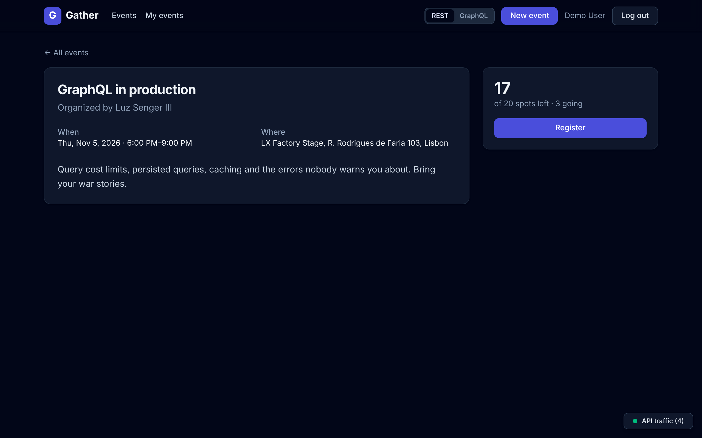
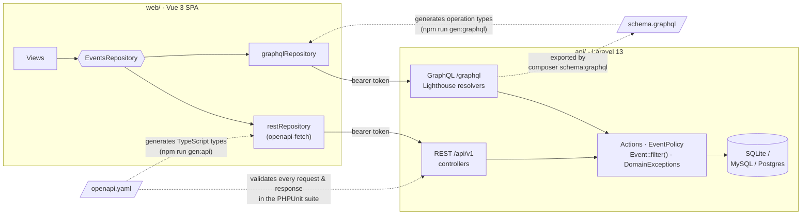

# Gather

[](https://github.com/GodfreysDragon/gather/actions/workflows/ci.yml)
[](LICENSE)

An events platform built **API-first**. A Laravel backend serves a versioned **REST API** and a **GraphQL API** over one
shared domain layer. A **separate Vue 3 SPA** talks to the backend only over HTTP, from another origin, and can switch
between the two APIs at runtime. The two halves are joined by a written contract ([`openapi.yaml`](openapi.yaml)) that
both sides are checked against in CI. This is how a backend team and a frontend team would work.


<p align="center">
  
  <br><em>Same screen, two transports: "My events" takes two REST calls or one GraphQL query.</em>
</p>

| Dark mode | Phone |
|---|---|
|  |  |

| REST reference at `/docs` | GraphQL playground at `/graphiql` |
|---|---|
|  |  |

## Architecture



```
gather/
├── openapi.yaml   ← the REST contract (source of truth for both sides)
├── schema.graphql ← the compiled GraphQL schema the SPA's types are generated from
├── api/           ← Laravel 13 · Sanctum · Lighthouse GraphQL · SQLite
├── web/           ← Vue 3 · TypeScript · Vite · Pinia · Tailwind 4
└── docs/          ← design decisions, screenshots
```

## Running it

Requirements: PHP 8.3+ with `pdo_sqlite`, Composer, and Node 22.18+ (or 24.12+).

```sh
# API on http://localhost:8000
cd api
composer setup                   # install, .env, app key, SQLite file, migrate + seed
php artisan serve

# SPA on http://localhost:5173, in a second terminal
cd web
npm install
cp .env.example .env             # VITE_API_URL=http://localhost:8000
npm run dev
```

Log in as **`demo@gather.test` / `password`**. The demo data is the same on every seed.

The two run on different origins on purpose. If you change either port, keep `VITE_API_URL` (web) and
`CORS_ALLOWED_ORIGINS` (api) in sync.

- REST: `http://localhost:8000/api/v1/…`, documented in `openapi.yaml` (also served at `/openapi.yaml`).
- GraphQL: `POST http://localhost:8000/graphql`, with the schema in `api/graphql/schema.graphql`.
- **Interactive docs:** the REST reference at `http://localhost:8000/docs` (Scalar, rendered from `openapi.yaml`, with
  "try it" against the running API) and a GraphQL playground at `http://localhost:8000/graphiql`.

## What it demonstrates

### One domain, two transports, no duplication
REST controllers and GraphQL resolvers are thin adapters over the same layer:

| Concern | Shared implementation |
|---|---|
| Business operations and their validation | `app/Actions/*` (`CreateEvent`, `UpdateEvent`, `DeleteEvent`, `RegisterForEvent`, `CancelRegistration`) |
| Authorization | `app/Policies/EventPolicy.php` (`Gate::authorize` in REST, `@canRoot` and `Gate` in GraphQL) |
| Filtering, visibility and sorting | `Event::filter()` scope, used by `GET /events` and the `events` query |
| Business-rule errors | `app/Exceptions/DomainException` subclasses, rendered as a problem document in REST and as `extensions.code` in GraphQL |
| Date-time input | `app/Rules/Iso8601DateTime`, used by REST validation and the GraphQL `DateTime` scalar |

A test asserts that REST and GraphQL return the **same events in the same order** for the same filters.

### Contract-first REST
- `openapi.yaml` is hand-written, and it is the source of truth.
- **Every REST call in the PHP test suite is also a contract test.** `tests/TestCase.php` validates each response
  against the spec for its route, method and status code. Each request the API accepts is validated as well. The
  test fails on an undocumented status code, a missing or wrongly typed field, or input the server accepts but the
  contract doesn't describe.
- The SPA **generates its TypeScript types from the same file** (`npm run gen:api`) and calls the API through
  `openapi-fetch`, so paths, parameters, bodies and responses are checked at compile time. CI fails if the generated
  types are stale.

### Typed GraphQL too
- The compiled schema is committed as [`schema.graphql`](schema.graphql) (`composer schema:graphql` in `api/`), and
  CI fails if it no longer matches the API.
- `graphql-codegen` validates every operation in `graphqlRepository.ts` against it and generates their result and
  variable types (`npm run gen:graphql`). Querying a removed field fails code generation; changing a field's type
  fails `npm run type-check`. CI fails if the generated types are stale.

### API design details
- **Versioned** under `/api/v1`, with consistent `{ "data": … }` envelopes and pagination `links` and `meta`.
- **RFC 9457 problem details** (`application/problem+json`) for every error: 401, 403, 404, 409, 422 (with per-field
  `errors`), 429 and 500. Business errors have stable `type` URIs, such as `/problems/event-full` and
  `/problems/capacity-conflict`.
- **Idempotent registration** as a singleton sub-resource:
  - `PUT /events/{id}/registration` returns 201 the first time and 200 after that;
  - `DELETE` can be retried safely;
  - the last spot is protected by a lock on the event row, and duplicate concurrent requests resolve to the same
    registration.
- **Business rules hold through every path:**
  - capacity can't drop below the current registrations;
  - an event's capacity must fit its venue, also after a venue change;
  - an event people registered for can't go back to draft.
- **Conditional GETs**: weak `ETag` and `If-None-Match` → `304`.
- **Rate limiting**: 120 requests/min per user or IP, and 10/min on the auth endpoints, keyed on IP + e-mail.
- **Stateless bearer tokens** (Sanctum personal access tokens). There are no cookies, so any client on any origin
  works the same way. CORS lists only the SPA's origin and exposes `ETag`, `Location` and `Retry-After`.
- **No existence leaks**:
  - someone else's draft is a 404, never a 403, for reads and writes alike;
  - e-mail addresses appear only on your own profile;
  - attendee lists are organizer-only.
- **UTC everywhere**: input must carry an offset, and output is always `…Z`.
- **No N+1 queries**: a test asserts that the listing runs the same number of queries for 2 events as for 12.

### GraphQL design details
- An idiomatic schema:
  - camelCase fields and `UPPER_CASE` enums;
  - a `Viewer` type for private fields;
  - nullable lookups (`event(id)` returns `null` when an event is hidden);
  - `RegistrationPayload` mutation results;
  - Lighthouse pagination with `paginatorInfo`.
- **Query complexity and depth limits** reject expensive queries, such as aliasing several 50-item pages, before any
  SQL runs. Introspection is exempt from the depth limit (it is bounded by the schema), so GraphiQL and code
  generators work.
- Validation errors use GraphQL field names (`input.endsAt`), even though the validation rules are shared with REST.
- Authentication belongs to REST: GraphQL accepts the same bearer token but doesn't issue tokens.

### A decoupled SPA
- The views depend on an `EventsRepository` interface (`web/src/domain/repository.ts`), not on a transport. It has
  two implementations, `restRepository` and `graphqlRepository`.
- The **REST | GraphQL toggle** in the header swaps the implementation at runtime, and every screen reloads through
  the other API unchanged.
- The **API traffic** panel logs each call with its transport, endpoint or operation, status, latency and size.
- Both transports' errors are normalised into one `ApiError`. A REST 409 `event-full` and a GraphQL `EVENT_FULL`
  look the same in the UI, and so do 422 field errors.
- **Robust data loading**: only the latest response wins, so a slow request never overwrites a newer one. An expired
  token clears the session and redirects to login, then returns you to where you were.
- **Accessible**:
  - labelled form errors (`aria-describedby`), with focus moved to the first invalid field;
  - focus moved to the page on navigation;
  - a native radio group for the transport toggle;
  - a `meter` for capacity.
- Responsive, with automatic dark mode.

## Tests

| Suite | Command | What it covers |
|---|---|---|
| API feature tests | `cd api && php artisan test` | 65 tests: auth, listing/filtering, CRUD, policies, registration rules, problem documents, ETags, rate limits, N+1, GraphQL queries/mutations/errors/limits, REST↔GraphQL parity, docs pages. Every REST request and response is validated against `openapi.yaml`. |
| SPA unit tests | `cd web && npx vitest run` | 41 tests: error normalisation for both transports, REST and GraphQL mappers producing identical UI models, stale-response handling, session expiry, form validation and focus, components |
| Type check / lint | `cd web && npm run type-check && npm run lint:check` | Including the generated REST and GraphQL types |
| End-to-end | `cd web && E2E_URL=http://localhost:5173 npm run test:e2e` | 13 checks in headless Chromium against the real API, through **both** transports: listing, filters, login, `event_full` rejection, register/cancel, server-side validation, create, "My events", phone layout, no console errors. `npm run test:e2e -- --dark` repeats it in dark mode. Needs both servers running on a freshly seeded database. |

All four run in [GitHub Actions](.github/workflows/ci.yml) on every push. The end-to-end job seeds a database, serves
the production build and uploads its screenshots as an artifact. `npm run capture` regenerates the images in this
README.

## Example requests

```sh
TOKEN=$(curl -s -X POST localhost:8000/api/v1/auth/login -H 'Content-Type: application/json' \
  -d '{"email":"demo@gather.test","password":"password"}' | jq -r .token)

curl -s 'localhost:8000/api/v1/events?city=Berlin&has_spots=true&sort=-starts_at' -H "Authorization: Bearer $TOKEN"

# Event 19 is the seeded sold-out coffee cupping
curl -s -X PUT localhost:8000/api/v1/events/19/registration -H "Authorization: Bearer $TOKEN" -H 'Accept: application/json'
# → 409 application/problem+json {"type":".../problems/event-full","title":"Event is full",...}

curl -s localhost:8000/graphql -H 'Content-Type: application/json' -H "Authorization: Bearer $TOKEN" -d '{"query":
  "{ me { name registeredEvents { title startsAt venue { city } } } }"}'
```

## Design notes

[`docs/DECISIONS.md`](docs/DECISIONS.md) covers why the project is built this way, the bugs the contract and
end-to-end tests caught during development, and the trade-offs it deliberately leaves open (token lifetime, venue
permissions, account enumeration).

## What's next

1. Cursor pagination for the event list, plus a `GET /events?updated_since=` feed for sync clients.
2. `Idempotency-Key` support for `POST /events`.
3. A production deployment: PostgreSQL, token expiry, and the SPA on a CDN.

## License

[MIT](LICENSE)
